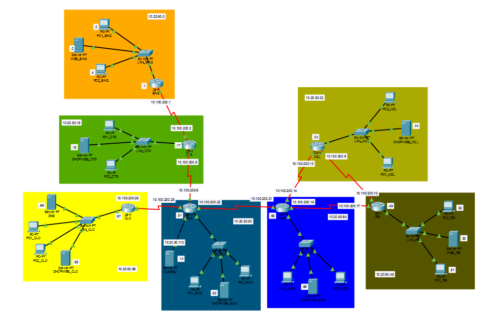

# Redes en Cisco Packet Tracer

Red WAN/LAN que conecta siete ciudades, con enrutamiento estático y los servicios de DHCP, DNS, correo y web. Trabajo académico hecho en Cisco Packet Tracer.

## Qué incluye
- 7 sedes: BAQ, CTG, BOG, CLO, MDE, MZL y PEI
- 7 routers Cisco 2911 conectados por enlaces WAN
- 2 PCs por cada LAN

## Direccionamiento
| Tipo | Red base |
|---|---|
| LAN | 10.20.50.X/28 |
| WAN | 10.100.200.X/30 |

## Servicios configurados
| Servicio | Detalle |
|---|---|
| Enrutamiento | Estático |
| DHCP | En cada LAN, excepto BAQ y PEI (direccionamiento manual) |
| DNS | Servidor en la LAN de CLO |
| Correo | Dominio `@ryc.edu.co`, servidor conectado a BOG, mínimo un usuario por LAN |
| Web | Un sitio por ciudad: `www.<ciudad>.edu.co` (el servidor web también entrega DHCP) |

## Cómo abrirlo
1. Descarga `topologia.pkt`.
2. Ábrelo con Cisco Packet Tracer **[versión, ej. 8.2]**.

## Qué aprendí
- Planificar el direccionamiento IP de una red con varias sedes
- Configurar enrutamiento estático entre routers
- Montar y probar servicios de red (DHCP, DNS, correo y web)
